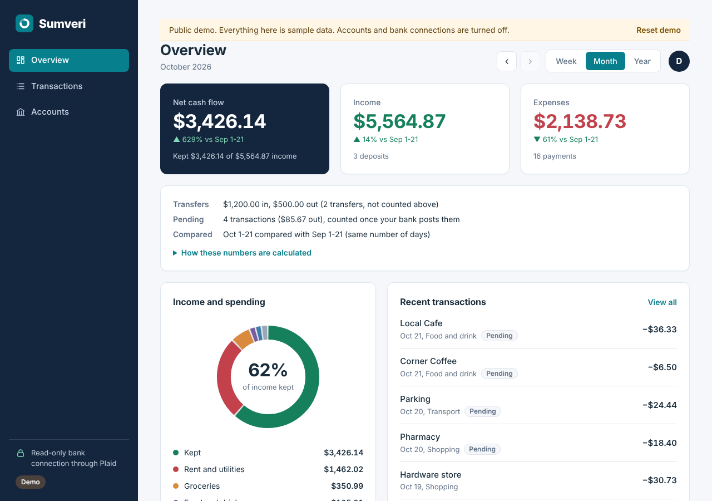
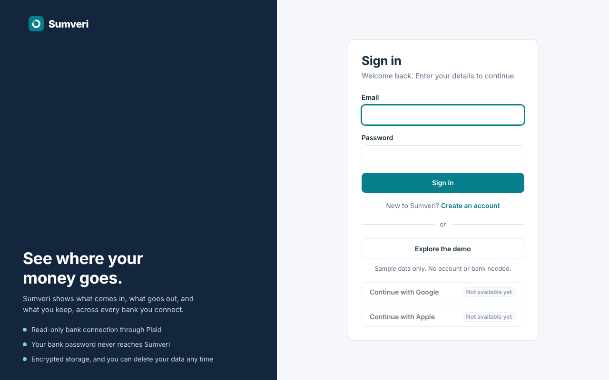
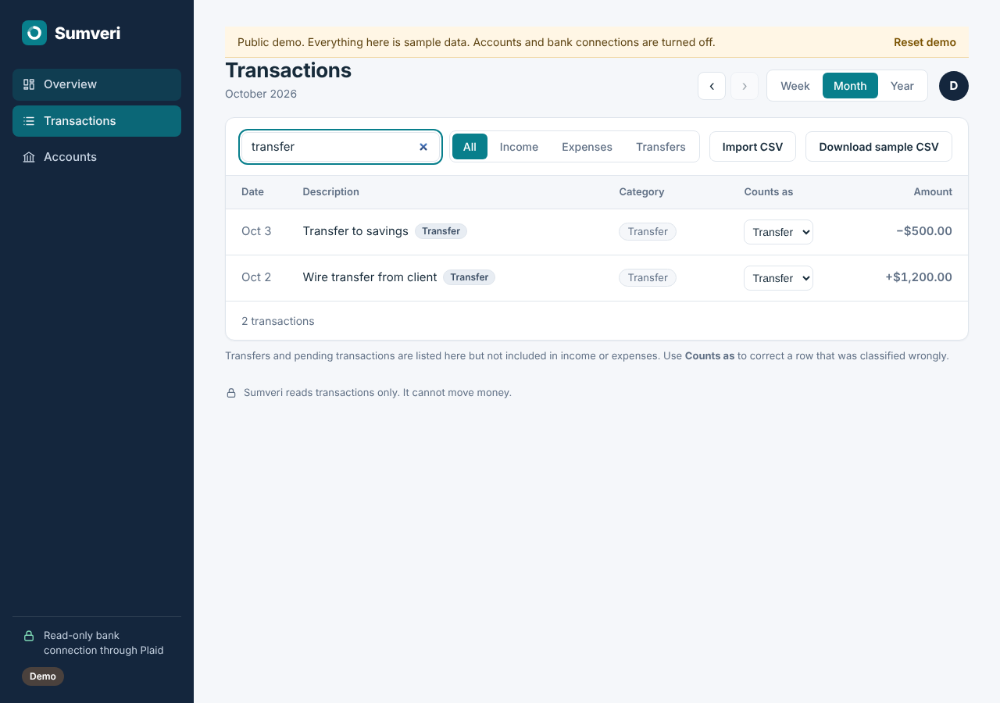
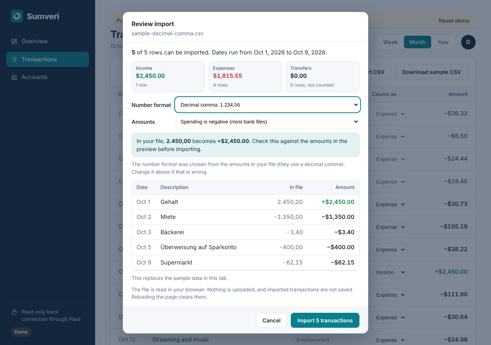

# Sumveri

A personal finance tracker. It connects to your bank through [Plaid](https://plaid.com) and shows what comes in, what goes out, and what you keep, for any week, month or year.

Built with Node.js, Express and vanilla JavaScript. It runs against Plaid's Sandbox (test banks), so no real bank data is needed.

**Project status:** runs locally; no hosted demo yet. Try the sample-data demo without an account or API keys using the instructions below. Optional hosting instructions are in [docs/HOSTING.md](docs/HOSTING.md).



| Sign in | Transactions | CSV import preview |
| --- | --- | --- |
|  |  |  |

## Try the demo in five minutes
No account, no Plaid keys. Click **Explore the demo** (or run the demo server, below) and:
1. **Overview.** This month has positive net cash flow. Press the back arrow: last month is negative (a car repair, dental work and flights). The percentages compare the same number of days, for example Oct 1-21 against Sep 1-21.
2. **Transactions.** Search "transfer". Filter by Income, Expenses or Transfers. Pending items are dimmed and tagged.
3. **Fix a classification.** "Wire transfer from client" starts as a transfer because of the word, but it is really income. Change **Counts as** to Income and watch the totals on the Overview change.
4. **Import a CSV.** Choose **Download sample CSV**, then **Import CSV**. The preview shows the amounts as they will be read and lists the one row with a bad date that will be skipped. Try [docs/sample-decimal-comma.csv](docs/sample-decimal-comma.csv) and switch **Number format** to see what a wrong choice does.
5. **Reset demo** restores the original sample data.

## Features
- **Explore the demo.** One click, sample data, kept in the browser tab, with a Reset button and a downloadable sample CSV. It never creates an account or touches a bank.
- **Net cash flow** (income minus expenses) with a comparison to the prior period, a donut chart of money kept versus spending by category, and a searchable transaction table.
- **Transfers are kept out of the totals, and you can overrule that.** Moves between your own accounts and credit card payments are shown, tagged "Transfer", and not counted as income or expenses. A **Counts as** menu (Income / Expense / Transfer) on every row corrects a wrong guess. For a linked bank the correction is saved to your account.
- **Pending transactions are explained.** They are listed, dimmed and tagged, left out of the totals, and counted once the bank posts them.
- **CSV import with a preview.** Shows what will be imported and what will be skipped (with row numbers and reasons), and the amounts as they will be read next to the text in the file. You choose the number format (decimal point 1,234.56 or decimal comma 1.234,56), how spending is signed, day-first or month-first dates, and whether to add to or replace what is shown. Dates are handled as calendar dates, so time zones cannot shift them.
- **Accounts.** Email and password sign-in, with each person's banks and transactions kept separate.
- **Bank linking** through Plaid Link with incremental syncing.
- Google and Apple sign-in are not built. The buttons are shown disabled and labeled "Not available yet".

## How the numbers are calculated
- Money is stored as whole cents, so totals never drift.
- Income is money in, expenses are money out. Transfers and pending items are excluded from both. **Net cash flow = income − expenses.**
- Weeks run Monday to Sunday. A period includes its first day and excludes the day after its last.
- **Comparisons use equivalent elapsed periods.** For a month still in progress, October 1-21 is compared with September 1-21, not with all of September. A finished period is compared with the whole period before it. This is shown on the Overview.
- **Number formats are never guessed from the file type.** A semicolon-separated file can still use decimal points, so the delimiter says nothing about decimals. Each format accepts only its own shape: with "Decimal comma" selected, `12.50` is refused rather than read as 1,250.00, and the preview shows the raw text beside the result.
- Known limit: a refund counts as income, because the app cannot tell it from a deposit.

## Run it locally
**Requirements:** Node.js 20 or newer.

**Just the demo:** install dependencies with `npm ci`, then start the demo:

```bash
# macOS / Linux
DEMO_ONLY=true npm start
```

```powershell
# Windows PowerShell
$env:DEMO_ONLY="true"
npm start
```

Open http://localhost:3000. To switch to test-bank mode in the same PowerShell session, first run `Remove-Item Env:DEMO_ONLY`.

**With a test bank:**
1. Get your `client_id` and **Sandbox** secret from https://dashboard.plaid.com (Developers, then Keys).
2. `npm ci`, then `npm run make-key` to generate an encryption key.
3. Copy `.env.example` to `.env` and fill in `PLAID_CLIENT_ID`, `PLAID_SECRET` and `ENCRYPTION_KEY`. Keep a backup of the key in a password manager.
4. `npm start`, open http://localhost:3000, create an account, then go to **Accounts** and click **Connect test bank**. In Plaid's window use `user_good` / `pass_good` (code `1234` if asked).

## Tests
```
npm test
```
No extra packages needed. The tests also run on every push through GitHub Actions (`.github/workflows/test.yml`, Node 20 and 22). They cover:
- financial calculations (transfers, pending items, cents, net cash flow, manual reclassification)
- date boundaries (week, month and year edges, leap years), elapsed-period comparisons, and CSV dates run under six time zones
- CSV import: decimal point and decimal comma, including semicolon files that use decimal points, wrong-format refusal, validation messages, amount signs, day/month order, merge and duplicates
- the demo data (positive and negative month, pending, transfers) on six different "today" dates
- sign-up, login, logout, cookies, rate limiting and cross-site request blocking
- two simultaneous sign-ups for one email creating one account, at the store level and over HTTP
- one user being unable to see, change, reclassify or disconnect another user's data
- hosting rules (HTTPS required, secure cookies, demo-only mode, sign-ups closed)

The real Plaid connection is not covered, because it needs live Plaid credentials. Tests use a fake Plaid.

## Security decisions
- **Passwords:** scrypt with a random salt per user, compared in constant time. Unknown emails and wrong passwords give the same error.
- **Sessions:** random 256-bit tokens in an HttpOnly, SameSite=Strict cookie (`__Host-` prefix and Secure when hosted). Only a SHA-256 hash is stored. They expire after 7 days and end on sign-out.
- **Per-user isolation:** every bank and transaction query is scoped to the signed-in user.
- **Secrets stay on the server.** The Plaid secret and access tokens never reach the browser.
- **Encrypted at rest.** The data file uses AES-256-GCM, with the key kept in the environment, separate from the data.
- **Local by default.** The server binds to `127.0.0.1` and rejects requests from other origins. Hosting needs deliberate settings (see below).
- **Hardened by default.** Content Security Policy and other headers via Helmet, rate limiting, a small JSON body limit.
- **Read-only.** Only Plaid's Transactions product is requested, so the app cannot move money.
- **No secrets in the repo.** `.env` and `data/` are git-ignored.

## Engineering decisions
**Why whole cents.** Floating-point money gives totals like 0.30000000000000004. Every amount is parsed once into an integer number of cents, summed as integers, and formatted only for display.

**Why the server holds the Plaid credentials.** The Plaid secret and each bank's access token would let anyone read that person's transactions. They exist only on the server, and no API response contains them (a test checks this). The browser only ever receives a short-lived link token and the cleaned transaction list.

**How each user's data is separated.** Every bank, transaction and correction query takes the signed-in user's id from the session, never from the request. A transaction id sent by another user returns "not found". Tests sign up two users and confirm one cannot read, reclassify or disconnect the other's data.

**Why the public demo disables accounts and banks.** A public page that stores strangers' passwords or bank tokens is a liability for a portfolio project. In demo mode the server has no store, no Plaid client and no secrets, and every account and bank route returns 404. Visitors still get the full dashboard, import and correction workflow on sample data held in their own browser.

**Why uniqueness is enforced at the save.** Checking "does this email exist" before hashing the password leaves a gap in which a second request can pass the same check. The check and the insert now happen in one synchronous step inside the store, and the loser gets a 409. A test fires simultaneous sign-ups and confirms one account.

**Why decimals are an explicit choice.** See "How the numbers are calculated". The cost of a wrong guess is a transaction that is silently 100 times too large, so the app shows both the raw text and the result before anything is imported.

### Bugs found and how they were tested
| Problem | Fix | Regression test |
| --- | --- | --- |
| Semicolon files were read as decimal commas, so `12.50` became $1,250.00 | Format is a visible choice; each format accepts only its own shape | `test/csv.test.js` (decimal tests) |
| Transfers counted as income and expenses | Transfers separated; manual override added | `test/finance.test.js`, `test/web.test.js` |
| A date such as `2026-01-01` could show as the day before in some time zones | Dates are never turned into Date objects from text | CSV parsing run in six time zones |
| Sign-out was blocked by the JSON content-type check | `/logout` exempted from that check | `test/web.test.js` (login/logout) |
| Two simultaneous sign-ups could create duplicate accounts | Uniqueness enforced inside the store | store and HTTP race tests |
| Two imported files could produce the same transaction id (`csv-2`), so editing one row changed another | Every import gets its own id prefix, and merging repairs any collision | `test/finance.test.js` (ids and labels) |
| A transfer corrected to income still showed "Transfer" as its category | Displayed category follows the correction | `test/finance.test.js` |
| "Prior month" comparison used a full month against a partial one | Equivalent elapsed days | `test/finance.test.js` (comparison tests) |

### My Role and Development Approach

I led Sumveri from concept through testing and refinement, defining the requirements, visual direction, feature priorities, and user experience. I configured Plaid Sandbox, ran the application locally, and evaluated its behavior throughout development.

I personally executed the automated tests and used AI to help interpret and verify the results. I directed successive improvements to financial calculations, CSV imports, account handling, and transaction classification.

AI generated the application code and automated tests. My contribution centered on product direction, integration setup, hands-on testing, and decisions about functionality and release readiness.

## Release checklist
- [x] Decimal-format, transfer-classification, duplicate-email and period-comparison issues fixed, each with regression tests
- [x] Desktop and phone-width browser check, including keyboard-only use (Tab order, Enter on links and buttons, Escape closing the import dialog, arrow keys in the Counts as menu)
- [x] Current screenshots in `docs/`
- [X] Tests passing on GitHub Actions (the workflow is included; this ticks after the first push)
- [ ] Public demo deployed and linked at the top of this file

## Hosting
See [docs/HOSTING.md](docs/HOSTING.md). The safest public option is `DEMO_ONLY=true`: sample data only, no secrets, no stored data.

## Limitations
- No password reset, email verification, two-factor sign-in or account deletion.
- All data shares one encryption key, and one server instance only (single encrypted file).
- Imported CSV transactions live in the browser tab and are not saved, so corrections to them are not saved either.
- Banks that require an OAuth redirect (many large banks in Production) are not handled yet.
- Google and Apple sign-in are not built.

## Publishing this portfolio project
See [the GitHub upload guide](docs/GITHUB.md) for repository setup and upload instructions.

## Project layout
```
server.js         Starts the server
lib/config.js     Settings and startup safety checks
lib/app.js        Routes and security middleware
lib/users.js      Accounts and sessions
lib/store.js      Encrypted storage, scoped per user
public/           Interface; finance.js holds the shared calculations and CSV parsing
test/             Automated tests
docs/             Screenshots and hosting guide
```
